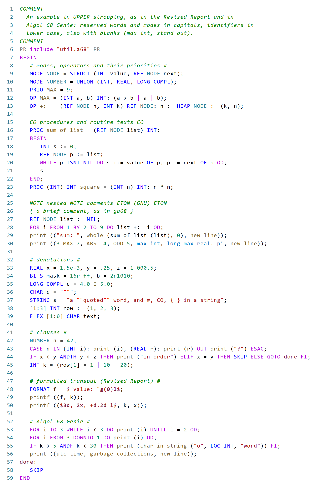
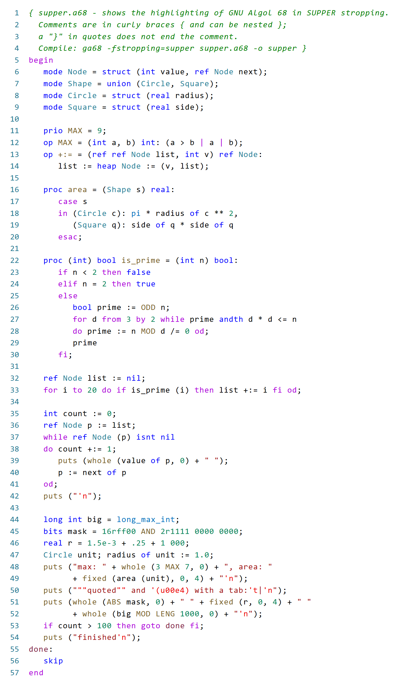

# Algol 68 TextMate grammar (UPPER and SUPPER stropping)

A TextMate grammar for Algol 68, scope `source.algol68`, file extension
`.a68`, also packaged as an extension for VS Code. It covers

- **UPPER stropping**: the Revised Report, Algol 68 Genie (keywords and
  standard prelude of version 3.5.9) and GNU Algol 68 (ga68) with
  `-fstropping=upper`;
- **SUPPER stropping**: GNU Algol 68 (ga68 with `-fstropping=supper`) and
  [a68j](https://github.com/stefan-zobel/a68j).

Quote stropping (`'BEGIN'`) is not covered.

## Contents

| Path | What |
|---|---|
| `syntaxes/algol68.tmLanguage.json` | the grammar |
| `package.json`, `language-configuration.json` | the VS Code extension: language `algol68`, comments, brackets, indentation |
| `examples/upper.a68`, `examples/supper.a68` | one example for each regime, shown above |
| `images/` | the examples, rendered with the grammar |

The grammar is generated by `tools/gen_tmlanguage_upper.py` in
[a68j](https://github.com/stefan-zobel/a68j) and checked there against the
scanner (see below). Changes go into the generator, not into
`syntaxes/algol68.tmLanguage.json`

## Installation in VS Code

Download `algol68-0.3.0.vsix` from the
[releases](https://github.com/stefan-zobel/language-algol68/releases) and
install it: Extensions view, menu "…", "Install from VSIX…", or

    code --install-extension algol68-0.3.0.vsix

Toggling a comment inserts `{ }`, which ga68 reads as a comment in both
regimes; Algol 68 Genie does not.

To package it yourself, run in this directory

    npx @vscode/vsce package

## Which stropping?

The two regimes contradict each other. In UPPER, `in`, `out`, `file`,
`real` and `to` are ordinary identifiers; in SUPPER they are reserved
words. `#`, `CO`, `COMMENT`, `PR` and `PRAGMAT` exist only in UPPER. A
TextMate grammar sees one line at a time, so the first word that tells the
regimes apart decides for the rest of the file:

| First such word | Regime |
|---|---|
| a reserved word in capitals (`BEGIN`, `PROC`, `INT`, `MODE`, `PR`, `CO`, ...) or `#` | UPPER |
| a reserved word in lower case (`begin`, `proc`, `int`, `mode`, ...) or `[[` | SUPPER |

Before that word, comments in braces, strings, numbers and names are
colored by rules that hold in both regimes. A program in UPPER declares its
identifiers with declarers in capitals, so a reserved word in capitals
comes before any identifier like `real` or `file`.

## What is highlighted (UPPER)

| What | Example | Scope |
|---|---|---|
| control words | `BEGIN IF THEN FOR DO OD CASE ESAC GOTO`, Genie: `UNTIL DOWNTO` | `keyword.control` |
| declarers | `MODE OP PRIO PROC REF FLEX HEAP LOC LONG STRUCT UNION` | `storage.type`, `storage.modifier` |
| standard modes | `INT REAL BOOL CHAR STRING BITS COMPL FILE FORMAT`, Genie: `COMPLEX PIPE SOUND` | `storage.type.primitive` |
| constants | `TRUE FALSE NIL SKIP EMPTY` | `constant.language` |
| word operators | `IS ISNT OF AT ANDTH OREL`, Genie: `ANDF ORF THEF ELSF ROW COL DIAG TRNSP` | `keyword.operator.wordlike` |
| modules (ga68) | `MODULE ACCESS PUB DEF FED POSTLUDE NEST` | `keyword.other.module`, `keyword.control.import` |
| modes of your own | `NODE` in `MODE NODE = ...`, `REF NODE` | `entity.name.type` |
| operators of the prelude | `ABS UPB LWB ODD MOD ENTIER REPR I`, Genie: `DET INV T` | `support.function.operator` |
| operators of your own | `MAX` in `OP MAX`, `PRIO MAX`, `a MAX b` | `entity.name.function.operator` |
| procedure definitions | `PROC sum of list = ...`, `f = (INT n) INT: ...` | `entity.name.function` |
| identifiers of the prelude | `print`, `new line`, `max int`, `long max real`, `stand out`, `char in string`, Genie: `utc time`, `argv` | `support.function`, `support.constant` |
| identifiers | `sum of list` (one name, with its blanks) | `variable.other` |
| labels | `done:`, `GOTO done` | `entity.name.label` |
| numbers | `42`, `1 000`, `1.5e-3`, `.25`, `16r ff`, `2r1010` | `constant.numeric.*` |
| strings | `"a ""quoted"" word"` | `string.quoted.double` |
| comments | `# ... #`, `CO ... CO`, `COMMENT ... COMMENT`, `NOTE ... ETON` (nestable), `{ ... }` | `comment.block` |
| pragmats | `PR include "x.a68" PR`, `PRAGMAT ... PRAGMAT` | `meta.preprocessor.pragmat` |
| format texts | `$"value: "g(0)l$` | `meta.format` |

**Mode or operator?** Both are bold words in capitals. After `MODE` comes a
mode, after `OP` and `PRIO` an operator. Elsewhere a bold word right after
an operand (an identifier, a number or a string, as in `a MAX b`) is an
operator, any other one a mode (`REF NODE`, `[n] NODE`).

**Names with blanks.** In UPPER the blanks inside an identifier do not
count: `sum of list` is one identifier, and `max int`, `maxint` and
`max_int` are the same name of the prelude. The grammar colors the whole
name.

## What is highlighted (SUPPER)

The same scopes, with the words of SUPPER stropping: reserved words in
lower case (`begin`, `int`, `if`, `module`, `access`), modes and operators
as bold words with a capital first letter (`Node`, `Int_list`, `ABS`,
`HAS`), identifiers in lower case with underscores (`max_int`, `is_prime`),
comments in braces, nestable, and the string escapes of ga68 (`'n`, `'t`,
`'(u00e4)`).

## Differences between the dialects

Where Algol 68 Genie and ga68 differ, the grammar follows ga68:

- `{ ... }` is a comment (in Genie, `{ }` are brackets).
- A comment ends at the first occurrence of its closing delimiter, as in
  both scanners: `CO` inside `SECOND` ends a `CO` comment.

Strings: Genie knows no escapes, and the GNU escapes `'n` and `'t` would
color the apostrophe in `"don't"` wrongly. So in UPPER only `""` and the
GNU escape `'(u00e4)` are colored.

## Checked against the scanner

In a68j the grammar is checked token by token against the scanner of a68j,
which follows the scanner of ga68 one to one (`tools/grammar_check.sh`, see
`docs/editor.md` there):

| Corpus | Regime | Files | Scanner tokens | Differences |
|---|---|---|---|---|
| ga68 test suite | UPPER | 435 | 28 474 | 0 |
| Rosetta Code, tests and modules of a68j | SUPPER | 1229 | 393 464 | 0 (2 UPPER programs detected as UPPER) |
| original Rosetta Code solutions (mostly Algol 68 Genie) | UPPER | 1259 | 362 593 | see below |

In the original Rosetta Code solutions, 91 files differ only in words of
Genie that ga68 does not reserve (`FORMAT`, `ROW`, `COL`, `ANDF`, ...); the
grammar colors them as Genie does. Of the other 9, six are not UPPER
programs (SUPPER, quote stropping, HTML, shell scripts), two declare a
reserved word anew (`MODE STRING = ...`, `OP ASSERT = ...`), which the
grammar colors as declared, and one continues an identifier over the end
of a line, which a grammar that sees one line at a time cannot follow.

## License

ISC, see `LICENSE`. The extension started from
[jlguenego/vscode-algol68](https://github.com/jlguenego/vscode-algol68)
(ISC); the grammar is written anew.
